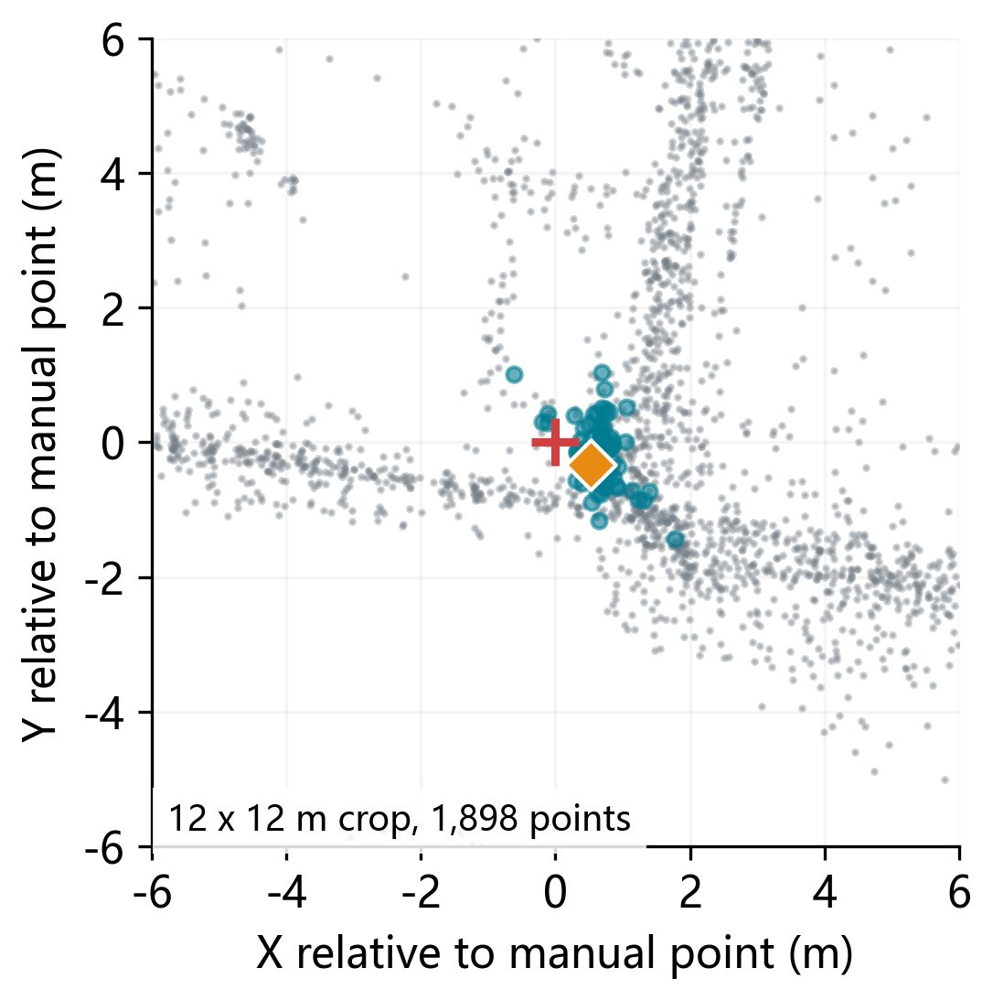
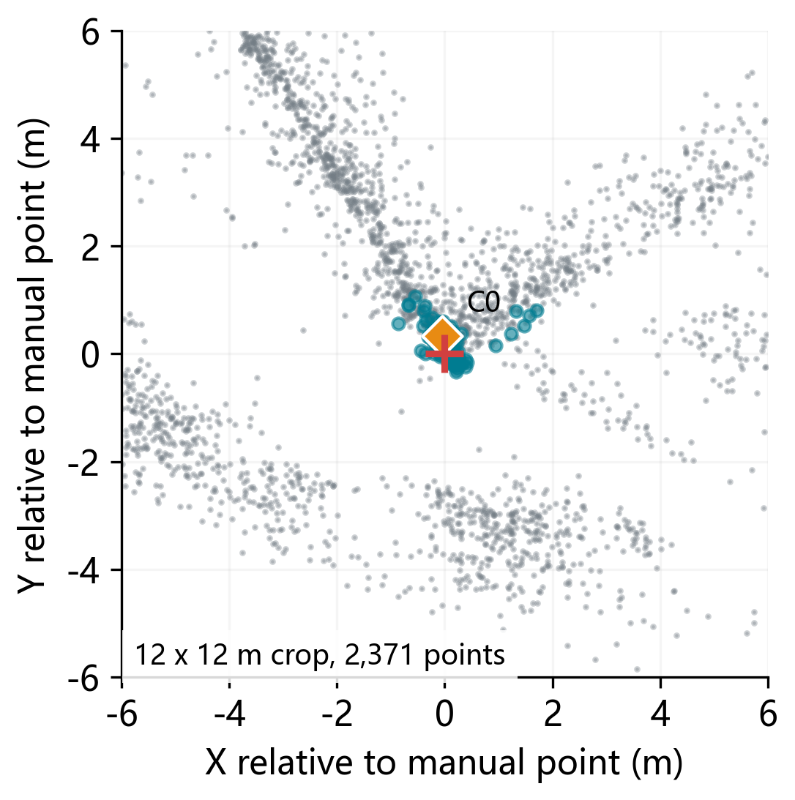
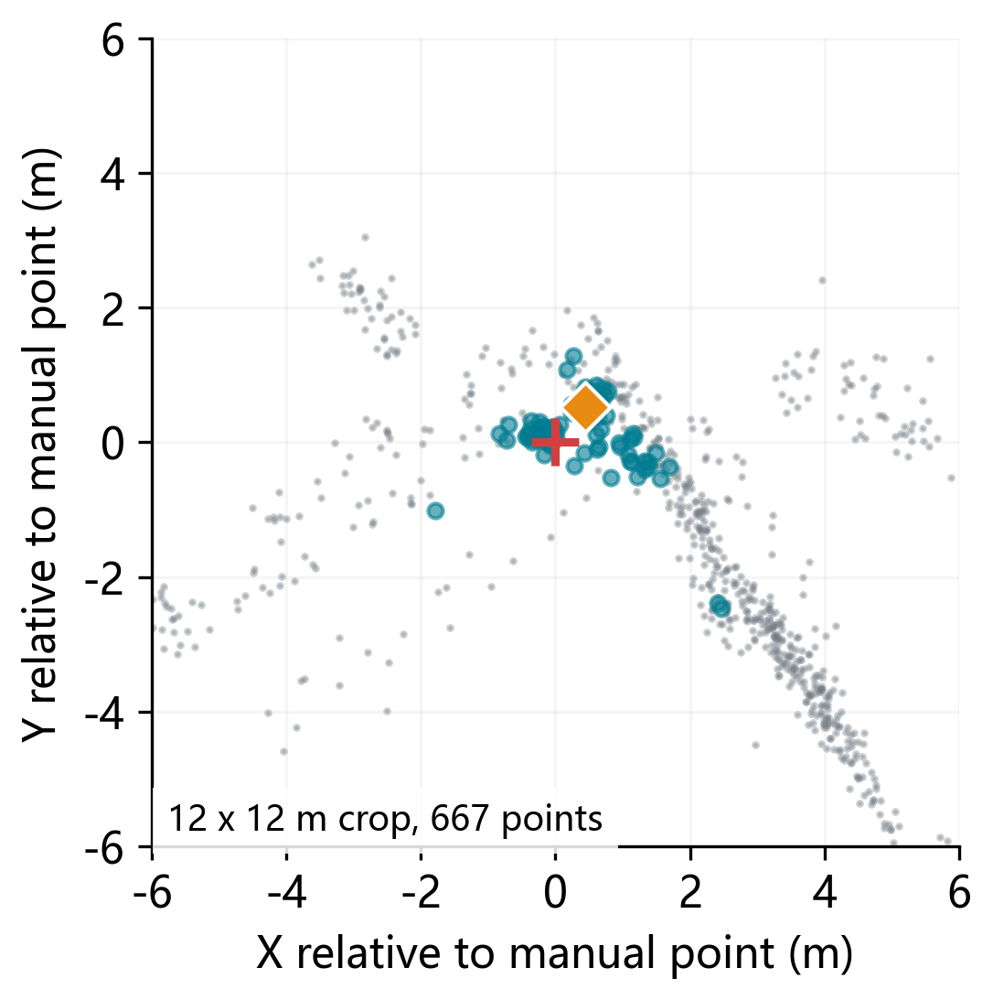
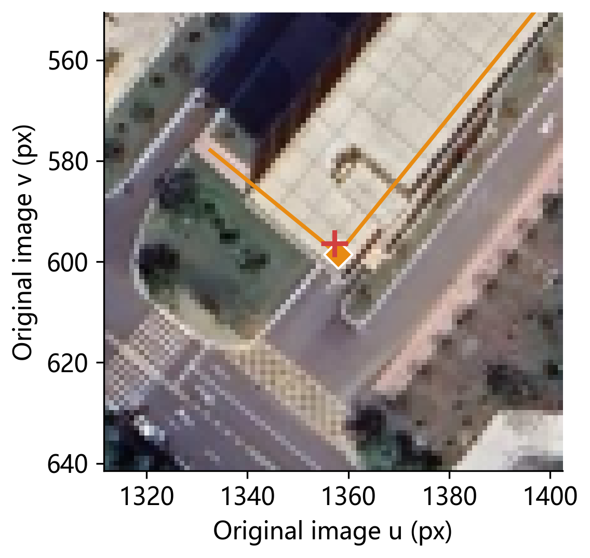
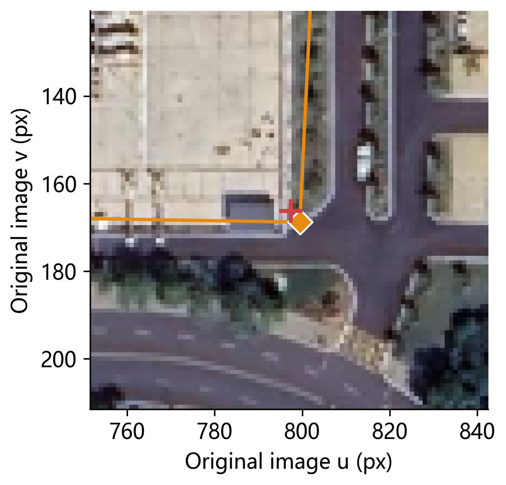
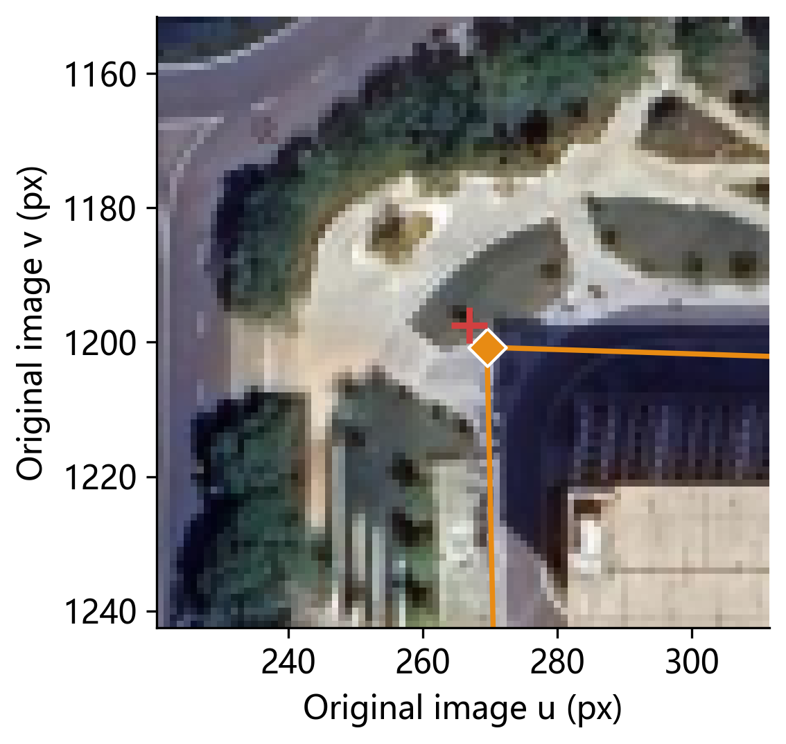

# SGAEval:Satellite-Guided Assessment of Structural Distortion in SLAM Point Cloud Maps

**Authors:** Yunfei Ma¹˒†, Gan Zou¹, Jun Cheng¹˒²˒*

**Affiliations:** ¹The School of Computer and Artificial Intelligence, Wuhan Textile University 　 ²The Intelligent Transportation System Research Center, Wuhan University of Technology

**†Project Lead** 　 **\*Corresponding Author**

[](https://icv-wtu.github.io/SGAEval/)
[](#)
[](https://opendatalab.org.cn/ICVGroup-WTU/SGAEval-DATASET/tree/main)
[](https://github.com/ICV-WTU/SGAEval-Satellite-Guided-Assessment-of-Structural-Distortion-in-SLAM-Point-Cloud-Maps)

## Overview

This project proposes two complementary metrics, **MLSD (Maximum Local Scale Deviation)** and **OCS (Offset Confidence Score)**, to assess the planar structural quality of outdoor SLAM point cloud maps when only satellite imagery or aerial orthophotos are available as a weak reference and dense 3D ground truth is absent. It addresses two fundamentally distinct aspects:

1. **Planar structural distortion (MLSD):** Using shared roads, intersections, and building boundaries as cross-modal anchors, it establishes correspondences between the point cloud map and the overhead reference, fits a planar map-to-reference transformation, and quantifies anisotropic scaling and shear through its normalized Jacobian singular values, taking the maximum deviation from local similarity over a fixed evaluation region.
2. **Correspondence reliability (OCS):** Using candidate combinations of raw/extracted corners, it measures the agreement of sampled corners with manual or estimated centers, and reports the MLSD mean, sensitivity range, and perturbation-based stability, characterizing how sensitive the result is to the choice of correspondences.

These two aspects are complementary and require different evaluation approaches: even when the map is well aligned globally, pronounced local anisotropic distortion may still occur; conversely, the magnitude of the distortion value also depends on whether the correspondences are stable and trustworthy. Our framework provides a unified pipeline that delivers both the distortion measurement and the confidence assessment.

This project includes the following computation flows and a single-page interface:

- MLSD: local Jacobian of affine/homography transforms, scale normalization, and maximum distortion over a fixed region.
- OCS: local scoring of raw/extracted corners, and map scoring after resampling-based fitting.
- Related flows: point cloud corner extraction, the necessary ground fitting and wall-support filtering, spatial-block Bootstrap, satellite corner association, candidate ambiguity, and branch-sample handling.
- GUI: based on the original `mlsd_ocs`, retaining loading of point clouds/satellite images/existing contours, correspondence selection, MLSD/OCS computation, overlay display, and import/export of point pairs/score results.

There are no trajectory/APE/RPE, other map metrics, model-inference bridging, corner-method comparison, checkpoint/annotation management, or batch experiments.

## Evaluation Pipeline

The evaluation pipeline relates the horizontal projection of a SLAM point cloud map to an overhead reference image. Correspondences between the same physical structures define a planar transformation, whose local scaling behavior provides the MLSD measurement.

- **Map-to-reference alignment.** Manually selected correspondences are used to fit an affine transformation or homography with RANSAC.
- **Local scale analysis.** At each evaluation location, the two Jacobian singular values are normalized by their geometric mean. MLSD is the maximum sampled deviation from local similarity over a fixed evaluation region.
- **Correspondence sensitivity.** OCS measures the agreement of sampled corner locations with manual or estimated centers. Valid corner candidate combinations yield an MLSD mean and range; a unique configuration also supports perturbation-based stability analysis.

## Dataset

The self-collected dataset provides two representative outdoor LiDAR sequences, **Campus** and **Road**, recorded on and around Wuhan Textile University for SLAM map evaluation.

- Portable acquisition: a passenger on an electric bicycle holds a **Livox HAP (TX)** LiDAR while traveling at approximately 20 km/h.
- **Campus:** 566 seconds of campus roads, turns, and surrounding buildings. **Road:** 271 seconds of off-campus roads with a larger mapping extent.
- Real-world evaluation: maps are reconstructed with **DLO** and **Livox Mapping**, paired with the corresponding **Google Earth satellite imagery**.
- The sensor's 120°×25° field of view yields limited observations of the surroundings, used to examine the resulting local and accumulated geometry.

| Sequence | Acquisition/Source | Duration | SLAM Reconstruction |
| --- | --- | --- | --- |
| Backpack2025 Seq.2 | Public sequence | – | DLO / Livox Mapping |
| Campus | Self-collected (Livox HAP) | 566 s | DLO / Livox Mapping |
| Road | Self-collected (Livox HAP) | 271 s | DLO / Livox Mapping |

**Backpack2025 Seq.2** is taken from a public dataset, sourced from the paper *Towards Degradation-Robust High-Precision Mapping: A Large-Scale LiDAR–Inertial Dataset*, [download link](https://pan.baidu.com/s/1NC8-gMOXunbzX-dPWTFZIQ?pwd=br28) (access code `br28`). Campus and Road are self-collected by our team, [download link](https://opendatalab.org.cn/ICVGroup-WTU/SGAEval-DATASET/tree/main).

## MLSD Results

We report MLSD alongside the available trajectory and point-cloud evaluation metrics. APE and RPE describe trajectory error, CD, AWD, and SCS measure geometric discrepancy or spatial consistency, and MLSD summarizes non-similarity in the fitted planar alignment. In the following table, "--" denotes metrics that are unavailable or inapplicable under the reference configuration. DLO Seq.~2 provides ground-truth poses but no ground-truth point cloud, allowing APE and RPE to be computed, whereas CD, AWD, and SCS remain unavailable.

| Sequence | SLAM method | APE ↓ | RPE ↓ | CD ↓ | AWD ↓ | SCS ↓ | MLSD ↓ |
| --- | --- | --- | --- | --- | --- | --- | --- |
| Seq.2 | DLO | 3.20 | 0.05 | – | – | – | **0.026** |
| Seq.2 | Livox Mapping | – | – | – | – | – | – |
| Campus | DLO | – | – | – | – | – | **0.014** |
| Campus | Livox Mapping | 19.94 | 0.14 | 44.18 | 0.56 | 0.47 | 0.083 |
| Road | DLO | – | – | – | – | – | 0.028 |
| Road | Livox Mapping | 180.91 | 0.37 | 113.92 | 1.03 | 0.45 | **0.018** |

## OCS Results

<table>
  <tr>
    <td align="center"><br><sub>A · Point 1 · Point cloud</sub></td>
    <td align="center"><br><sub>B · Point 2 · Point cloud</sub></td>
    <td align="center"><br><sub>C · Point 3 · Point cloud</sub></td>
  </tr>
  <tr>
    <td align="center"><br><sub>D · Point 1 · Satellite</sub></td>
    <td align="center"><br><sub>E · Point 2 · Satellite</sub></td>
    <td align="center"><br><sub>F · Point 3 · Satellite</sub></td>
  </tr>
</table>

## Quick Start

### Dependencies

- Python 3.10 or above
- NumPy: the core and only mandatory dependency for pure numerical computation
- OpenCV, Open3D: the automatic point cloud corner pipeline (reusing the original project's implementation)
- Pillow: image file entry
- PyQt6, Matplotlib: the single-page GUI, as optional dependencies

### Installation

Choose the install scope according to the features you need:

```powershell
# Numerical core only (MLSD/OCS API)
python -m pip install .
# When automatic point cloud extraction and image corners are needed:
python -m pip install ".[geometry,image]"
# To use the single-page GUI and the full point cloud pipeline:
python -m pip install ".[gui,geometry]"
```

### Input Data

Evaluation requires correspondences on both sides, and the coordinates must point to the same physical corner:

| Input | Description | Source |
| --- | --- | --- |
| Point cloud | In meters, shape `(N, 3)` | `mlsd_ocs_core.ocs_geometry.load_pointcloud(path)` or an existing NumPy array |
| Satellite image | Original image pixel coordinates | Loaded in the GUI, or used as the corner reference |
| Manual correspondences | Image pixel XY and point cloud XY, row-wise matched | GUI point picking or a point-pair JSON |

### Launch the GUI and Run Evaluation

Run the following in the project root:

```powershell
python main.py
```

After installation, `python -m mlsd_ocs_core` or `mlsd-ocs` also works. The interface is a single MLSD/OCS page; follow these steps:

1. Load the satellite image and the point cloud.
2. First pick points on the satellite image, then select the corresponding points in the top-down point cloud view; repeat to obtain at least 3 pairs for affine and 4 pairs for homography. An existing point-pair JSON can also be loaded.
3. Click `Compute MLSD` to view the values and the overlay result.
4. Use `Load contours (JSON)` to load the satellite polygons already available for the image, confirm the correspondence identities, set Bootstrap/MC and the thresholds, then click `Compute OCS`.
5. Save point pairs or the MLSD/OCS scores and overlay results as needed.

## Citation

If this work is useful for your research, please cite:

```bibtex
@article{ma2026sgaeval,
  title   = {SGAEval: Satellite-Guided Assessment of Structural Distortion in SLAM Point Cloud Maps},
  author  = {Ma, Yunfei and Zou, Gan and Cheng, Jun},
  journal = {Preprint submitted to Elsevier},
  year    = {2026}
}
```

## License

This project is licensed under the Apache License 2.0 License. See the [LICENSE](LICENSE) file for details.
